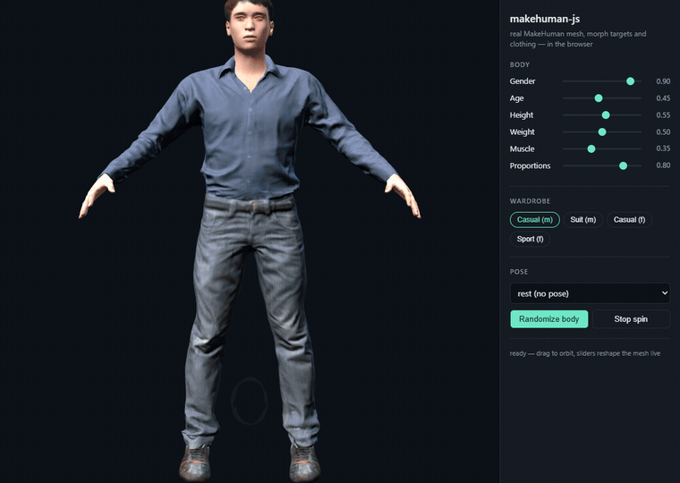

# makehuman-js-new

[](https://github.com/HippocampusEvolve/makehuman-js-new/actions/workflows/ci.yml)
[](LICENSE)

Fork of [makehuman-js](https://github.com/makehuman-js/makehuman-js) — a JavaScript library that
builds 3D human models in the browser — kept buildable on current Node.js.

The original project by [wassname](https://github.com/wassname) hasn't been updated since 2017.



The figure above is the **real MakeHuman base mesh** — 19 158 vertices, 138 MB of morph
targets, and fitted garments from `makehuman-data` — running in a browser, not a procedural
stand-in.

## Demo

```bash
npm ci
npm run build      # bundles dist/makehuman.js
npm run example    # serves http://127.0.0.1:8080/example/
```

[`example/`](example/) is a ~250-line page with no dependencies beyond what this repo already
ships: three r82 from `node_modules`, the bundle from `dist/`, and the meshes, morph targets
and clothing from `node_modules/makehuman-data`. Sliders (gender, age, height, weight, muscle,
proportions) reshape the mesh live; the wardrobe buttons swap outfits, hair and eyebrows.

The upstream [makehuman-js-example](https://github.com/makehuman-js/makehuman-js-example)
needs six CDN libraries and an `npm install` that fails on node-gyp in 2026, which is why this
one lives in-tree.

## Status

This fork is a **working baseline, not a rewrite**. The source and the toolchain are still the
original 2017 ones; what this repo adds is a verified answer to "does it still build?" and a
demo that proves the library still renders.

| | Version here | Notes |
|---|---|---|
| Three.js | `^0.82.1` (r82) | the code targets the pre-r125 API (`Geometry`, old materials) |
| Webpack | `2.1.0-beta.21` | builds `makehuman.js` (2.6 MB) without patching |
| Babel | 6 (`es2015` + `stage-1` presets) | |
| ESLint | 3 with `airbnb` config | |
| Node.js | 18 / 20 / 22 | `npm ci && npm run build` verified in CI on all three |

Planned, in rough order: Webpack 5 + Babel 7 (mechanical), ESLint 9 flat config, then Three.js
r1xx — the last one is the expensive step, because everything after r125 removed `Geometry` and
reworked the material and loader APIs this code is built on. Until that lands, the README will
not claim it.

### Known defects

Found while building the demo; all of them are upstream behaviour, not regressions of this fork:

- **Poses tear the hands apart.** `setPose()` writes each pose quaternion into `bone.parent`
  (`src/js/human/human.js`), and along the wrist/finger chain the result is wrists and fingers
  stretched into long ribbons. Every pose in `makehuman-data` is affected, so the demo starts in
  rest pose; picking a pose in the UI reproduces it. The body, clothing and face are unaffected.
- **Loading a clothing proxy corrupts unrelated scene geometry.** A `THREE.GridHelper` added to
  the same scene came back with the garment's 50 016 vertices in its buffer and rendered as a
  white wireframe shirt under the model. The demo keeps the scene minimal because of it.
- **`setPose()` logs `couldnt find bone metatarsal*`** — the poses reference foot bones the
  skeleton does not carry. Harmless, but noisy.

## Original Project

- **Repo:** [makehuman-js/makehuman-js](https://github.com/makehuman-js/makehuman-js)
- **Author:** Mike Clark ([wassname](https://github.com/wassname))
- **Original demo:** [mhwebui.wassname.com](http://mhwebui.wassname.com/)
- **Example:** [makehuman-js-example](https://github.com/makehuman-js/makehuman-js-example)

## Usage

```bash
git clone https://github.com/HippocampusEvolve/makehuman-js-new.git
cd makehuman-js-new
npm ci
npm run build    # bundle to dist/makehuman.js
npm start        # dev server with hot reload
npm test         # opens a browser with the mocha suite
```

`npm run build` is the path covered by CI. `npm start` and `npm test` both rely on
`webpack-dev-server@2.1.0-beta` and open a browser, so they are not run there.

## Acknowledgement

This project is based on [makehuman-js](https://github.com/makehuman-js/makehuman-js) by wassname, which was inspired by the desktop Python software [makehuman.org](http://www.makehuman.org/). Data and models are provided by the MakeHuman project — thanks to all contributors listed [here](http://www.makehuman.org/halloffame.php).

## License

[AGPL-3.0](LICENSE) — same as the original project.

Code outputs are CC0. Data/models remain under the MakeHuman project license.
